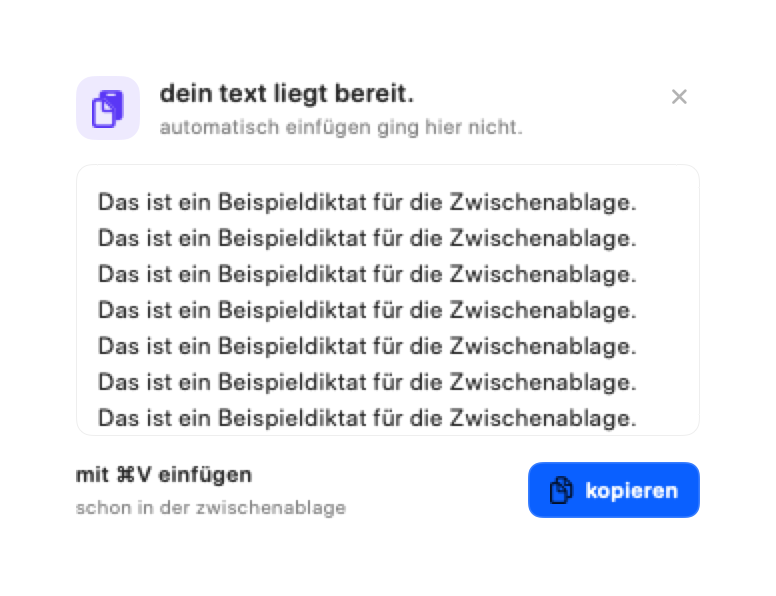
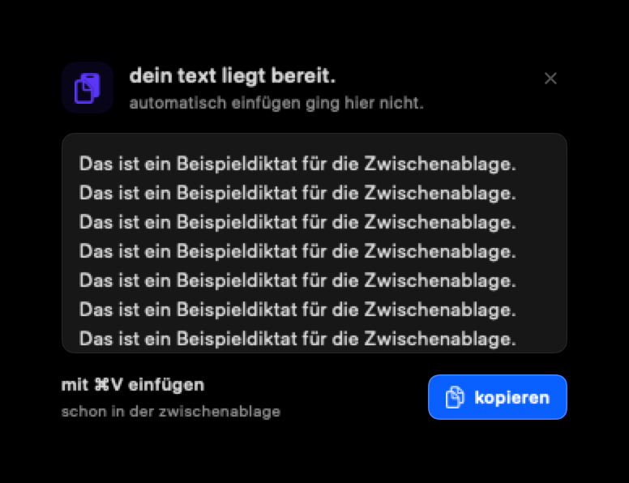

# Clipboard and menu continuity

## Bounded reconnaissance

- User: the Mac owner needs every completed dictation available for later Cmd+V, and opens the menu during recording to access modes and settings.
- Access: native single-user app, no hosted tenants or roles. Existing Accessibility, secure-field retention guards, and local/online boundaries remain in effect.
- Reuse: extend AppState delivery, MenuBarView, RecordingPillView and existing clipboard/design primitives.
- Limits: retain recording caps, context limits, busy-start protection, bounded fallback preview and its existing 18-second lifetime. No new network or persistence layer.

## Acceptance criteria and implementation plan

1. Copy final output before attempting insertion. Keep it on the clipboard after success or failure, until another copy replaces it. Preserve the concealed clipboard marker.
2. Opening the menu during recording or processing shows normal navigation; existing settings remain selected. Starting a second workflow still cannot interrupt the current one.
3. Show only a compact recording/processing status in normal navigation. The floating pill remains the recording control.
4. Refine the fallback card using existing violet, rounded typography and card/button styles: clear copied state, readable scrollable preview, Cmd+V guidance, copy feedback and dismissal.
5. Run focused regressions, the complete XCTest suite, universal app build, review, push, and install/launch the local app with its existing llama.cpp helper.

Complexity: medium. Risks: clipboard privacy changes are intentional and documented; signing and helper preservation must be verified during installation. No additional dependencies.

## Verification and review

- Regression RED: opening the menu during recording or processing replaced main/settings navigation with the workflow page. The new tests reproduced this before the fix.
- Regression GREEN: all eight focused navigation/clipboard tests passed, including delayed clipboard retention and a later user copy.
- Complete XCTest suite: 372 tests passed, zero failures. Readiness tests now inject credential availability instead of reading the owner's real Keychain; production uses the same Keychain lookup as before.
- Universal Release: arm64 and x86_64 built successfully; signed app bundle passed deep/strict codesign verification.
- Swift formatting lint for new sources and changed tests, diff whitespace check, and changed-file secret hygiene scan passed.
- Code review: no new critical/high findings; concealed clipboard marking, secure-field archive/context guards, busy-start protection, and provider boundaries remain intact. Existing compiler/asset warnings remain outside this change.
- Native AppKit snapshots of the card content were inspected in both appearances. These verify content layout, not the live Liquid Glass panel or a microphone-to-target-app journey. Direct UI access to the installed menu-only app timed out.

## Xcode 16.2 compatibility follow-up

GitHub CI exposed an older Swift compiler restriction: an actor-isolated method reference in a default argument is evaluated from a nonisolated context. Replace that default argument with an explicit no-argument overload, keeping both the native paste command and the injectable test path on MainActor. This preserves delivery behavior and avoids actor-isolated default argument evaluation.

The next CI run exposed a pre-existing toolchain mismatch: Liquid Glass wrappers require the macOS 26 SDK, but CI and release workflows selected Xcode 16.2. Both workflows now use the macOS 15 runner with Xcode 26.2 explicitly selected, matching the verified local toolchain. Build prerequisites document Xcode 26+; the deployment target remains macOS 14. This change does not trigger a release tag or publish an appcast.
